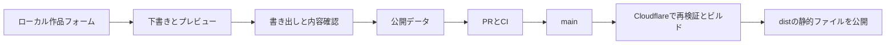

# システム設計

2026-10-19更新。公開サイトとローカル編集を分けた、HTML / CSS / Vanilla JavaScriptの静的サイト。

## 公開ページ

| ファイル | 内容 |
| --- | --- |
| index.html | 表紙、自己紹介、作品、年表、Favorites |
| about.html | 所属と活動、制作・発表の年表 |
| portfolio.html | 作品一覧と検索 |
| 404.html | 存在しないページの案内 |
| portfolio-theme.css | 公開ページとローカル編集画面の共通テーマ |
| public.js | 公開データからの一覧・Contact描画、検索、ナビゲーション |
| project-cards.js | 公開ページと管理画面で共有するカードの表示処理 |
| data/portfolio-projects.js | 本人確認を経た公開作品情報 |
| data/contact-links.js | 公開してよいプロフィールURL |
| images/BRAND_ASSETS.txt | 公式素材の取得元とファイルの確認情報 |

公開ページはlocalStorageを読まない。HomeとWorksは同じ作品情報とカード描画関数を使う。Homeでは受賞実績を持つ作品を紹介し、空の改善計画は表示しない。自己紹介と年表は現段階ではHTMLの手動更新。

## ローカル編集

- developer-admin.htmlが開発者ツールの入口。
- portfolio-admin.htmlが作品フォーム。project-cards.jsとローカル用script.jsを使う。
- learning-admin.htmlとdata/learning-tasks.jsは手元の開発記録用。
- learning.htmlは互換用として残すが、公開ナビ・公開ビルドには含めない。
- styles.cssは旧管理フォーム等のスタイル。公開ページは読み込まない。
- 下書きはフォームがある画面だけで読み書きし、書き出しとレビューを経て公開データへ反映する。
- 保存キーstudyfolio-learning-admin-tasks-v1、studyfolio-portfolio-admin-projects-v1は既存下書きとの互換性のため維持する。
- localStorageはブラウザとオリジンごとの一時保存。file://からlocalhostへは自動移行しない。下書きだけをバックアップとして扱わない。

## 配布と更新

- config/public-files.jsonが公開ファイルの明示リスト。フォルダーやHTMLを一括コピーしない。
- scripts/site-lib.mjsがソース・リンク・画像・データ・配布範囲と内容一致を検証する。
- scripts/release.mjsが検証、distの再生成、成果物検証を順に行う。再生成前に出力先がリポジトリ内のdistであることを確認する。
- scripts/build-dist.shは既存のNetlify設定との互換入口であり、release.mjsを呼ぶ。旧来のdata/*.jsやimages/*コピーは行わない。
- scripts/preview.mjsはdistだけを127.0.0.1:4173で提供する。--developerの場合は許可したローカル編集画面を127.0.0.1:4174で提供する。docsやworkをディレクトリごと提供しない。
- .github/workflows/site-check.ymlでPR・push時にソース検証とブラウザ確認を実行する。権限はcontents: read。
- wrangler.jsonでWorkers Static Assetsの配布先を./dist、未存在パスを404-pageに指定する。任意のパスへindex.htmlを返すSPA設定は使わない。
- Cloudflareのプロジェクト名とwrangler.jsonのnameはportfolioで一致させる。observability.enabledはfalseを明示してWorkers Logsの保存設定を同期する。公開URLの有効化とCloudflare Accessによる閲覧認証は別の設定として扱う。
- _headersに再検証可能なキャッシュと基本ヘッダーを設定する。公開後にCloudflareの応答でも確認する。

公開サイトには管理HTML、管理処理のscript.js、学習データ、試作HTML、資料原本や確認記録を含めない。公開GitHubリポジトリにコミットしたコード自体を秘匿する仕組みではない。秘密情報を使う構成ではなく、管理フォームはオンラインの認証済み管理システムとしては扱わない。

## 外部読み込み

公開ページの文字はシステムフォントとGeorgia。Spotifyは本人提供の公式iframeを使用し、内部プレイヤーを加工しない。旧ローカル管理画面にはGoogle Fonts参照が残る。公開サイトのバックエンドAPIやデータベースは設けていない。

## 検証と現段階の範囲

Node.js 24と既存Edgeで、公開24ファイル、15画面幅、文字拡大9通り、非公開パス11個の404、検索・キーボード・下書き分離・管理フォーム編集を確認。許可外のファイルがdistへ混入すると失敗することも確認した。scripts/check-browser.mjsはGitHubのUbuntuランナー上では既存Chromeを使用する設定。

GitHub CIはPRごとに結果を確認する。本番のGit連携、保護ルール、実デプロイ、Spotify実再生はアカウント接続後に確認する。手順はPUBLISHING.md。オンラインCMS、学習記録からAboutへの自動反映、未承認の個人担当・成果の追記は未実装。